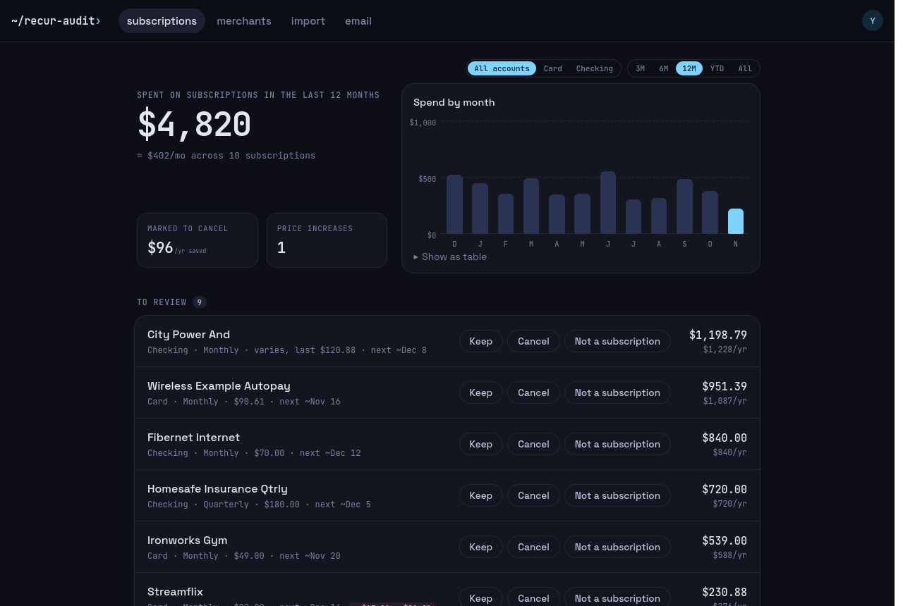
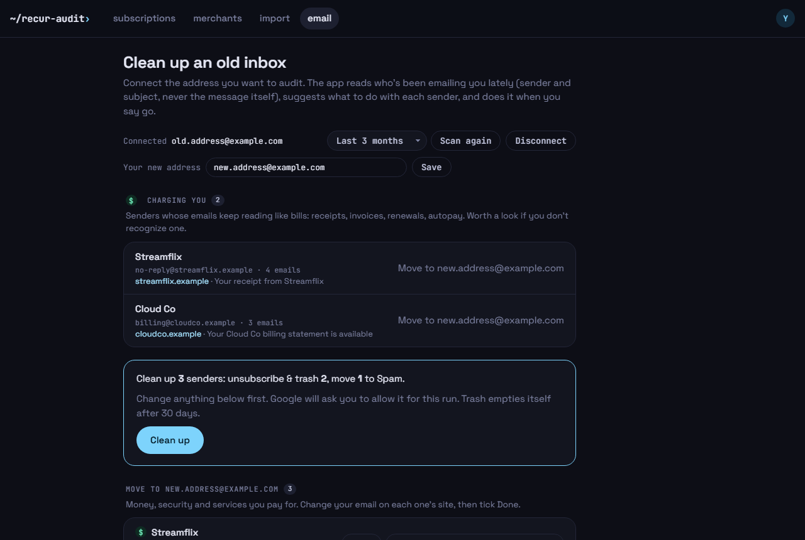

# recur-audit

Finds the recurring charges in your bank statements and cleans up an old Gmail inbox.

It's local first. It runs on your own computer, everything lives in one SQLite file, and nothing leaves your machine unless you connect Gmail, and even then only email headers are read. The same container runs on an always-on box behind Tailscale, and everyone only sees their own data.

<p>
  
  
</p>

## Features

- Import statements as CSV, OFX or QFX, several at a time. Rows repeated across overlapping statements are skipped.
- Detect recurring charges, with cost, price increases and charges that stopped. Filter by period and account.
- Rename and merge merchants, and sort them into categories. A language model you host can suggest the categories.
- Scan the last 1, 3 or 12 months of a Gmail inbox's headers, and sort each sender into move to your new address, unsubscribe & trash, spam or keep. Senders billing you on repeat are grouped at the top. Clean up does the rest in one step; message bodies are never read.

## Run it

Requires Docker or Podman. Settings go in a `.env` file next to `compose.yaml`.

**On your own computer** (start here). Put `RECUR_AUDIT_LOCAL_USER=you@example.com` in `.env`, run `docker compose up -d --build`, and open http://localhost:8000. That's it.

**For a household.** On an always-on machine with [Tailscale](https://tailscale.com), leave `RECUR_AUDIT_LOCAL_USER` out of `.env`, then:

```sh
docker compose up -d --build
tailscale serve --bg --https=8443 http://127.0.0.1:8000
```

Open `https://<machine>.<tailnet>.ts.net:8443`. Tailscale tells the app who each person is, so everyone needs their own Tailscale user. Use `serve`, never `funnel`, which would put the app on the public internet.

- Update: `git pull && docker compose up -d --build --force-recreate` (Podman keeps the old container without it)
- Logs: `docker compose logs -f`
- Back up: `docker compose cp app:/data ./backup`

## Gmail

You use your own Google Cloud project, so no one else's app ever touches your mail.

1. In the [Google Cloud console](https://console.cloud.google.com/), create a project and enable the Gmail API.
2. Create credentials for **User data** (not application data). On the consent screen add two scopes, `gmail.metadata` and `gmail.modify`, and add each address you'll connect as a **test user**. Leave it in testing.
3. Make the OAuth client a **Web application**. Its redirect URI is the address you open the app at plus `/email/callback`, such as `http://localhost:8000/email/callback`.
4. Add the keys to `.env` and run `docker compose up -d` again:

   ```sh
   GOOGLE_CLIENT_ID=...
   GOOGLE_CLIENT_SECRET=...
   RECUR_AUDIT_PUBLIC_URL=https://<machine>.<tailnet>.ts.net:8443   # only when served through Tailscale
   ```

How access works:

- **Connect** saves a read-only sign-in (`gmail.metadata`). Google itself blocks it from reading messages; it only sees senders, subjects and labels.
- **Clean up** asks you to approve `gmail.modify` once, for that run. The app keeps it in memory only, never saves it, and Google expires it within an hour.
- **Disconnect** revokes everything and deletes what the scan stored.

Google warns the app is unverified when you connect. That's expected, since it's your own app; continue past it. Sign-ins last 7 days while the app is in testing. Clean up really unsubscribes and moves mail to Trash or Spam, so try it on a throwaway address first.

## Category suggestions (optional)

Suggest categories on the Merchants page asks a language model you host, such as llama.cpp's `llama-server`. It only sees merchant names and one bank description each. Add its OpenAI-compatible address to `.env`:

```sh
RECUR_AUDIT_LLM_URL=http://169.254.1.2:8081/v1
RECUR_AUDIT_LLM_MODEL=qwen3.6-35b
```

If the model listens on the host's `127.0.0.1`, with Podman, add a `compose.override.yaml` (gitignored) so the container can reach it at `169.254.1.2`:

```yaml
services:
  app:
    network_mode: "pasta:--map-host-loopback,169.254.1.2"
```

## Development

```sh
python -m venv .venv
.venv/bin/pip install -e ".[dev]"
.venv/bin/python -m pytest
.venv/bin/uvicorn app.main:app --port 8000
```

Settings come from the same `.env` file as Docker (`RECUR_AUDIT_LOCAL_USER=you@example.com` at minimum), so secrets never go on the command line. Open the app at http://localhost:8000; other hostnames are refused. Without Docker, data goes in `data/`. `python scripts/make_demo_data.py` writes sample statements to `data/demo/`; run with `RECUR_AUDIT_DATA_DIR=data/demo` to use them.

Design notes: [DECISIONS.md](DECISIONS.md).
